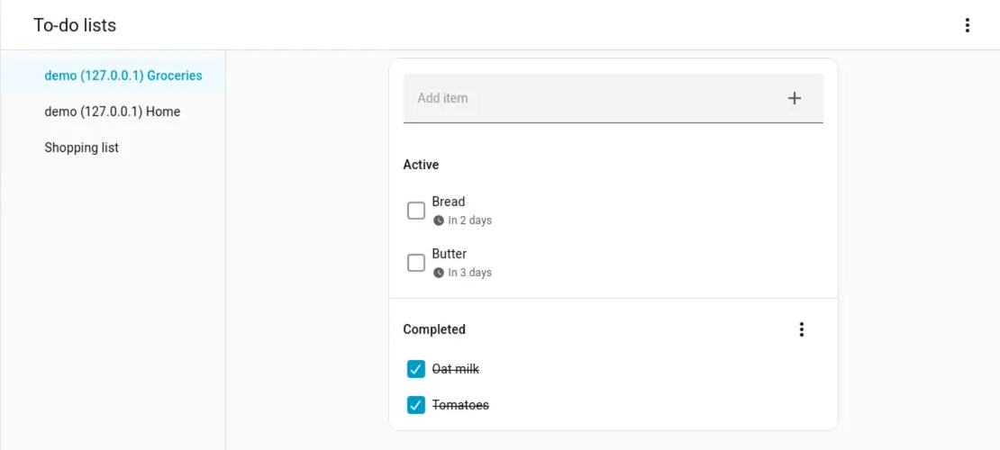

  

<h1 align="center">EteSync for Home Assistant</h1>

  Your end-to-end encrypted <a href="https://www.etesync.com/">EteSync</a> task lists as Home Assistant to-do lists.

  
  
  
  
   
  
  
  
  

## Features

- **Multiple accounts**: add the integration once per EteSync account, on the hosted service or on your own [Etebase server](https://github.com/etesync/server).
- **Every task list becomes a to-do list** in the Home Assistant to-do panel, on dashboards, in automations and in Assist. Lists created, renamed, shared with you or deleted in EteSync appear and disappear automatically.
- **Two-way sync**: add, rename, complete, re-open and delete tasks, and set due dates (with or without a time) and descriptions. Changes from your other devices show up within a minute.
- **Plays nicely with other clients**: only the fields you change are touched. Alarms, categories, priorities, sub-task links, time zones and properties written by other apps are preserved. If a task was changed on another device in the meantime, the change is applied on top of the newest version.
- **Shared read-only lists** are shown but cannot be edited.
- **Works on Home Assistant OS**: the Etebase protocol is implemented in pure Python on top of PyNaCl, which Home Assistant already ships. See [why](#why-not-the-official-etebase-library).
- **Efficient**: after the first sync, only what changed since the last poll is downloaded.
- Re-authentication when the session cannot be renewed, diagnostics download, and a log-out of the session when you remove an account.

## Installation

### HACS (recommended)

1. In HACS, open the menu (⋮) → **Custom repositories**, add `https://github.com/ch-rit/ha-etesync` with type **Integration**.
2. Search for **EteSync**, download it and restart Home Assistant.

### Manual

1. Download `etesync.zip` from the [latest release](https://github.com/ch-rit/ha-etesync/releases/latest).
2. Unpack it into `config/custom_components/etesync/` and restart Home Assistant.

## Configuration

Go to **Settings → Devices & services → Add integration → EteSync** and enter:

| Field | Description |
| --- | --- |
| Server URL | Keep `https://api.etebase.com/partner/etesync/` for the hosted EteSync service. For a self-hosted Etebase server, enter its base URL, for example `https://etebase.example.com/` (without `/api/v1/`). |
| Username | Your EteSync username. |
| Password | Your EteSync password. It is used to log in and is **not** stored. |

Repeat this for every account you want to add. Each account becomes a service device with one to-do entity per task list, for example `todo.alice_groceries`.

The account must have been used with an official EteSync app at least once; the integration does not create new accounts.

## How tasks are mapped

| EteSync (iCalendar VTODO) | Home Assistant |
| --- | --- |
| `SUMMARY` | Item name |
| `STATUS` `COMPLETED` or `CANCELLED` | Completed (like the EteSync apps) |
| any other `STATUS` | Needs action |
| `DUE` (date or date-time) | Due date / due date and time |
| `DESCRIPTION` | Description |
| `COMPLETED` | Completion time |

Items are listed in the "smart" order of the EteSync web app: open tasks first, then by priority, due date, title and most recently modified. When you complete a task, `STATUS:COMPLETED` and a `COMPLETED` timestamp are written; re-opening removes them.

### Limitations

- Calendars and address books are not imported, only task lists (`etebase.vtodo` collections).
- Completing a recurring task marks it completed; no next occurrence is created.
- Sub-tasks are shown as a flat list, and items cannot be re-ordered (EteSync has no stored order).
- Creating, renaming and deleting task lists has to be done in an EteSync app.
- Changes are polled every minute; real-time push is not supported.

## Security and privacy

EteSync encrypts everything end-to-end, and the integration decrypts your tasks locally in Home Assistant. The password is only used to derive the account key during login and is not stored. Home Assistant does store the resulting **session**, which contains the account's main key, in its configuration (`.storage/core.config_entries`), the same way the official EteSync apps keep you logged in. Anyone with access to your Home Assistant configuration or its backups can therefore decrypt your EteSync data. Protect them accordingly.

Removing the integration logs the session out on the server. Diagnostics contain neither credentials nor task content.

## Why not the official Etebase library?

The official [`etebase`](https://pypi.org/project/etebase/) Python package is a Rust extension that is only published for glibc (`manylinux`), macOS and Windows. Home Assistant OS and the official container run on Alpine Linux (musl), so the package cannot be installed there without a Rust toolchain. This integration therefore includes a small pure-Python implementation of the parts of the Etebase protocol it needs ([`custom_components/etesync/etebase/`](custom_components/etesync/etebase/)), built on PyNaCl/libsodium. It is tested:

- against the known-answer test vectors of [etebase-rs](https://github.com/etesync/etebase-rs), and
- in CI against a real Etebase server, together with the official client: data written by either client is read back by the other, including sessions, deletions, conflicts and multi-chunk content.

## Troubleshooting

- **Invalid username or password / account not initialized**: log in once with an official EteSync app and check the server URL.
- **Re-authentication required**: the stored session was revoked (for example after a password change). Enter your password again in the notification.
- Enable debug logging on the integration page (⋮ → **Enable debug logging**), reproduce the issue and attach the log and the downloaded diagnostics to a [bug report](https://github.com/ch-rit/ha-etesync/issues/new/choose).

## Contributing

Contributions are welcome! See [CONTRIBUTING.md](CONTRIBUTING.md) for the development setup, tests and the local Etebase test server.

## License

The integration is released under the [MIT license](LICENSE). The Etebase protocol implementation in `custom_components/etesync/etebase/` is a port of etebase-rs, © 2020 Etebase Authors, and is licensed under [LGPL-2.1-only](LICENSES/LGPL-2.1-only.txt) (upstream notice: [BSD-3-Clause](LICENSES/BSD-3-Clause-etebase-rs.txt)).

This project is not affiliated with or endorsed by EteSync. EteSync and the EteSync logo are trademarks of their respective owners.
